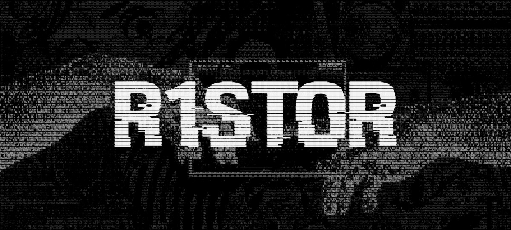

<div align="center">

<!-- HEADER: положи свою шапку в корень репозитория как header.png (или поменяй путь ниже) -->


</div>

### // tools

**recon / osint**  
[](https://nmap.org) [](https://github.com/smicallef/spiderfoot) [](https://github.com/thewhiteh4t/seeker)

**web / exploitation**  
[](https://portswigger.net/burp) [](https://www.wireshark.org)

**privesc**  
[](https://github.com/peass-ng/PEASS-ng/tree/master/linPEAS) [](https://github.com/peass-ng/PEASS-ng/tree/master/winPEAS)

**defense**  
[](https://www.elastic.co/security)

**companion**  


**environment**  
[](https://www.kali.org) [](https://www.python.org) [](https://www.gnu.org/software/bash/) [](https://kernel.org)

<div align="center">

```
── connection terminated ──
```

</div>
